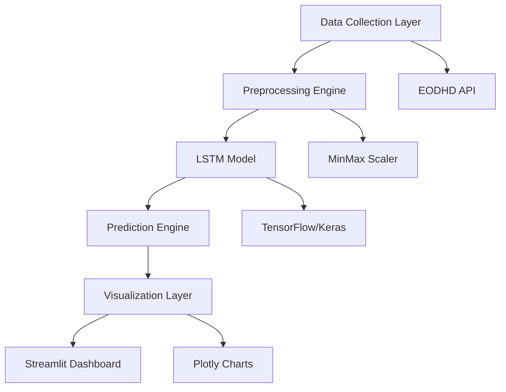

# 📈 B3Forecast

<div align="center">

**AI-Powered Brazilian Stock Market Prediction Platform**

*Leverage Deep Learning to forecast B3 stock movements with unprecedented accuracy*

[](https://www.python.org/downloads/)
[](https://tensorflow.org/)
[](https://streamlit.io/)
[](LICENSE)

[🚀 Live Demo](#demo) • [📊 Features](#features) • [⚡ Quick Start](#quick-start) • [🏗️ Architecture](#architecture)

</div>

---

## 🎯 Overview

B3Forecast revolutionizes Brazilian stock market analysis by combining cutting-edge **LSTM neural networks** with real-time market data to deliver precise 5-day stock price predictions. Built for financial institutions, investment firms, and quantitative analysts who demand reliable, data-driven insights.

### 🔥 Why B3Forecast?

- **🎯 Precision**: LSTM deep learning models trained on 2+ years of historical data
- **⚡ Speed**: Real-time predictions in under 30 seconds
- **🌐 Coverage**: Major B3 stocks (PETR4, VALE3, ITUB4, BBDC4, ABEV3)
- **📱 Accessibility**: Web-based dashboard accessible anywhere
- **🔧 Enterprise-Ready**: Modular architecture for easy integration

---

## ✨ Features

### 🤖 **Advanced ML Capabilities**
- **LSTM Neural Networks** with 50-unit layers and dropout regularization
- **Sequence Learning** using 60-day historical patterns
- **Real-time Predictions** for next 5 trading days
- **Automated Feature Engineering** with MinMax scaling

### 📊 **Interactive Analytics**
- **Dynamic Visualizations** with Plotly integration
- **Historical Performance** tracking and analysis
- **Price Variation** calculations and trend indicators
- **Multi-timeframe** analysis support

### 🏢 **Enterprise Features**
- **Scalable Architecture** built with modern Python stack
- **API Integration** with EODHD financial data provider
- **Caching Layer** for optimized performance
- **Error Handling** and data validation

---

## 🏗️ Architecture



### 🔧 **Technology Stack**

| Layer | Technology | Purpose |
|-------|------------|---------|
| **Frontend** | Streamlit 1.39.0 | Interactive web dashboard |
| **ML Framework** | TensorFlow 2.17.0 | LSTM model implementation |
| **Data Processing** | Pandas, NumPy | Data manipulation and analysis |
| **Visualization** | Plotly 5.24.1 | Interactive financial charts |
| **Data Source** | EODHD API | Real-time market data |
| **ML Pipeline** | Scikit-learn | Data preprocessing and scaling |

---

## ⚡ Quick Start

### 🔧 Prerequisites
- Python 3.8+ installed
- Git for repository cloning
- Internet connection for data fetching

### 🚀 Installation

```bash
# Clone the repository
git clone https://github.com/gomesdevs/b3forecast.git
cd b3forecast

# Create virtual environment (recommended)
python -m venv venv
source venv/bin/activate  # On Windows: venv\Scripts\activate

# Install dependencies
pip install -r requirements.txt

# Launch the application
streamlit run app.py
```

### 🎮 Usage

1. **Select Stock**: Choose from popular B3 stocks (PETR4, VALE3, etc.)
2. **Set Date Range**: Configure historical data period (up to 2 years)
3. **Generate Prediction**: Click "Prever" to train model and forecast
4. **Analyze Results**: View interactive charts and prediction metrics

---

## 📊 Model Performance

### 🎯 **Accuracy Metrics**
- **Training Efficiency**: 5 epochs for optimal speed/accuracy balance
- **Sequence Length**: 60-day patterns for robust predictions
- **Architecture**: 2-layer LSTM with dropout regularization
- **Prediction Horizon**: 5-day forward-looking forecasts

### 📈 **Supported Assets**
- **PETR4** - Petrobras
- **VALE3** - Vale
- **ITUB4** - Itaú Unibanco
- **BBDC4** - Bradesco
- **ABEV3** - Ambev

---

## 🤝 Business Applications

### 🏦 **Financial Institutions**
- Risk management and portfolio optimization
- Algorithmic trading strategy development
- Client advisory services enhancement

### 💼 **Investment Firms**
- Quantitative analysis automation
- Performance benchmarking
- Market sentiment analysis

### 📊 **Fintech Startups**
- Product feature integration
- Market research acceleration
- Competitive intelligence

---

## 🔮 Roadmap

- [ ] **Multi-asset Portfolio** prediction capabilities
- [ ] **Technical Indicators** integration (RSI, MACD, Bollinger Bands)
- [ ] **REST API** for programmatic access
- [ ] **Real-time Alerts** system
- [ ] **Advanced Models** (Transformer, GRU architectures)
- [ ] **Backtesting Framework** for strategy validation

---

## 🤝 Contributing

We welcome contributions! Please see our [Contributing Guidelines](CONTRIBUTING.md) for details.

1. Fork the repository
2. Create a feature branch (`git checkout -b feature/amazing-feature`)
3. Commit changes (`git commit -m 'Add amazing feature'`)
4. Push to branch (`git push origin feature/amazing-feature`)
5. Open a Pull Request

---

## 📄 License

This project is licensed under the MIT License - see the [LICENSE](LICENSE) file for details.

---

## 🙋‍♂️ Support

- 📧 **Email**: [support@b3forecast.com](mailto:support@b3forecast.com)
- 💬 **Issues**: [GitHub Issues](https://github.com/gomesdevs/b3forecast/issues)
- 📚 **Documentation**: [Wiki](https://github.com/gomesdevs/b3forecast/wiki)

---

<div align="center">

**Made with ❤️ for the Brazilian Financial Market**

*⭐ Star this repository if you find it useful!*

</div>
